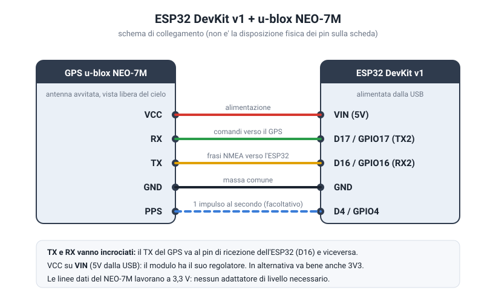
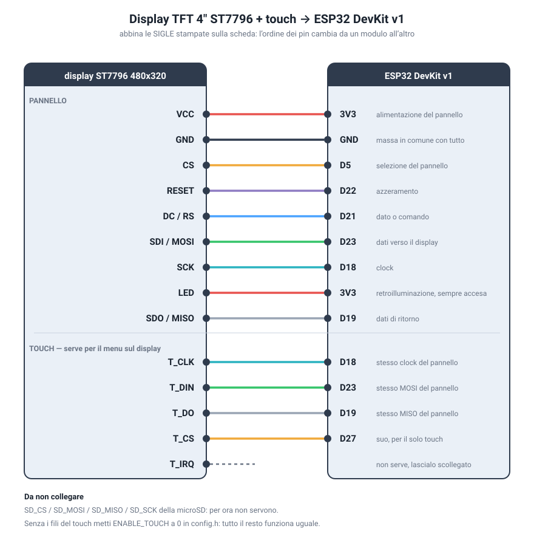

# ESP32 GPS Tracker con geofence

Progetto completo per l'hardware della foto: **ESP32 DevKit v1** (ESP32-WROOM-32)
e **modulo GPS u-blox NEO-7M** con antenna esterna.

L'ESP32 legge la posizione dal NEO-7M e:

* pubblica una **dashboard web** (mappa live, velocita', satelliti, HDOP, quota, distanza dalla base);
* **registra la traccia nella memoria interna**: sopravvive allo spegnimento, quindi in auto non
  perdi il viaggio quando togli il contatto. Si esporta in **GPX**, un segmento per accensione,
  pronto per Google Earth, Strava o QGIS;
* tiene le **statistiche del viaggio** (distanza, velocita' massima, tempo in movimento) e un
  **odometro totale** che non si azzera;
* fa da **navigatore a freccia con le svolte**: disegni il percorso dal telefono, che lo fa
  passare per le strade vere e si fa dare le manovre; in auto il display annuncia la svolta
  con distanza e nome della strada, senza rete
  del prossimo punto, quanto manca e l'avviso di fuori rotta, continuando a registrare la traccia;
* tiene l'elenco delle **tappe con nome**, lette dal GPX o aggiunte dal telefono toccando la
  mappa: sul display leggi "Ponte sul Foglia", non "punto 47 di 340";
* si fa configurare il **WiFi dal telefono**: se non trova la rete salvata apre un proprio
  access point con una pagina per sceglierne una, senza ricompilare niente;
* sorveglia un'**area circolare (geofence)**: quando il tracker esce o rientra invia l'evento a
  **SinricPro** come contact sensor + notifica push sul telefono (passo facoltativo);
* segnala lo stato con il **LED blu** della scheda, cosi' si capisce cosa sta succedendo anche senza PC.

Tutto gira sull'ESP32: nessun server esterno, nessuna SD, nessun file da caricare a parte il firmware.

---

## 1. Materiale

| Pezzo | Note |
|---|---|
| ESP32 DevKit v1 (30 pin, ESP32-WROOM-32) | quella della foto |
| Modulo GPS u-blox NEO-7M (GY-NEO7M) | con antenna attiva avvitata sull'SMA |
| 4-5 jumper femmina/femmina | |
| Cavo USB dati | molti cavi da ricarica non hanno i fili dati |
| *(facoltativo)* TFT 4" ST7796 480x320 SPI | computer di bordo, vedi sotto |

---

## 2. Collegamenti



| Modulo GPS | ESP32 DevKit v1 | Perche' |
|---|---|---|
| `VCC` | `VIN` (5 V dalla USB) | il modulo ha il suo regolatore; va bene anche `3V3` |
| `GND` | `GND` | massa comune, obbligatoria |
| `TXD` | `D16` / GPIO16 (RX2) | le frasi NMEA arrivano all'ESP32 |
| `RXD` | `D17` / GPIO17 (TX2) | **facoltativo**: comandi verso il GPS, serve solo con `GPS_CONFIGURE_UBX` |
| `PPS` | `D4` / GPIO4 | facoltativo: 1 impulso al secondo quando c'e' il fix |

Per ricevere la posizione **bastano tre fili**: `VCC`, `GND` e `TXD`.

Tre errori che costano un pomeriggio:

* **TX e RX vanno incrociati**: il `TXD` del modulo va sul pin di ricezione dell'ESP32 (`D16`).
* **Non usare i pin dell'ESP32 marcati `RX0`/`TX0`** (GPIO3 / GPIO1): sono la seriale della
  USB, il firmware legge su UART2. Hanno sigle simili a quelle del GPS, e' una trappola.
* **L'ordine dei pin cambia da modulo a modulo.** Sul HW-542 della foto, da sinistra:
  `PPS RXD TXD GND VCC`. Leggi sempre le sigle stampate sulla basetta, mai la posizione.

> L'antenna deve vedere il cielo. Dentro casa, lontano da una finestra, il fix non arriva
> quasi mai: il primo aggancio "a freddo" richiede 30-60 secondi all'aperto, anche qualche
> minuto se il modulo e' rimasto spento a lungo.

---

## 3. Compilazione e caricamento

### Windows, con un doppio clic

In `tools/windows/` ci sono due script.

**`aggiorna.bat`** - da usare quando esce una versione nuova: scarica le novita' con git,
mette da parte le tue modifiche a `config.h` e le rimette dopo, ti elenca cosa e' cambiato,
poi compila e carica. E' il modo piu' comodo di stare aggiornati.

**`carica-firmware.bat`** - compila e carica quello che hai gia' in cartella. Se PlatformIO
manca lo installa, poi apre il log seriale.

1. Doppio clic su **`tools\windows\carica-firmware.bat`**
2. Premi Invio sul menu (la prima voce e' quella giusta)

Il menu offre anche solo-log, solo-compilazione, ricompilazione pulita e **caricamento
via WiFi**. Da riga di comando
si possono passare le stesse opzioni:

```powershell
.\tools\windows\carica-firmware.bat -SoloMonitor
.\tools\windows\carica-firmware.bat -Porta COM7
```

L'unico prerequisito e' **Python 3** (da [python.org](https://www.python.org/downloads/),
spuntando *Add python.exe to PATH*): se non c'e', lo script lo dice e si ferma senza fare
danni. La prima compilazione scarica toolchain e librerie, anche diverse centinaia di MB.

### PlatformIO a mano

```bash
cd projects/esp32-gps-tracker
pio run -t upload -t monitor
```

`platformio.ini` scarica da solo TinyGPS++, ArduinoJson, WebSockets, SinricPro e TFT_eSPI.

> ArduinoJson e' bloccato alla **versione 6**: l'SDK SinricPro 2.x non compila con la 7.

### Arduino IDE

```bash
./tools/make_arduino_sketch.sh
```

Lo script genera `arduino/EspGpsTracker/` con i tre file nel formato che l'IDE si aspetta.
Poi: scheda **ESP32 Dev Module**, e dal Library Manager installa *TinyGPSPlus* (1.0.3 o superiore),
*ArduinoJson (6.x)*, *WebSockets* e *SinricPro*.

---

## 4. Configurazione

Si lavora solo su [`src/config.h`](src/config.h), e con la versione attuale **non e'
obbligatorio toccare niente**: se le credenziali WiFi restano quelle di esempio, al primo avvio
il tracker apre il proprio access point e la rete la scegli dal telefono (vedi sotto). Se invece
preferisci averla gia' pronta:

```c
#define WIFI_SSID  "LA-TUA-RETE-WIFI"
#define WIFI_PASS  "LA-TUA-PASSWORD"
```

Le voci che probabilmente vorrai toccare:

| Voce | Default | A cosa serve |
|---|---|---|
| `GEOFENCE_LAT` / `GEOFENCE_LON` | Duomo di Milano | centro dell'area sorvegliata (modificabile anche dalla dashboard) |
| `GEOFENCE_RADIUS_M` | 150 m | raggio dell'area |
| `MIN_SATELLITES` / `MAX_HDOP` | 4 / 5.0 | soglie di qualita': sotto queste la posizione viene scartata |
| `TRACK_MIN_DISTANCE_M` | 10 m | quanto ti devi spostare prima di registrare un nuovo punto |
| `TRACK_FILE_MAX_POINTS` | 12000 | capienza del file traccia (~20-30 ore di guida) |
| `AP_SSID_PREFIX` / `AP_PASSWORD` | GPS-Tracker / gpstracker | nome e password dell'access point del portale |
| `ROUTE_OFF_ROUTE_M` | 60 m | quanto puoi allontanarti dal percorso prima dell'avviso |
| `ROUTE_MIN_SPACING_M` | 15 m | quanto vengono diradati i punti del GPX caricato |
| `ROUTE_DRAW_SPACING_M` | 50 m | passo con cui si riempiono i tratti del percorso disegnato a mano |
| `TURNS_MAX` | 200 | quante svolte stanno in memoria |
| `TURN_NAME_LEN` | 20 | caratteri del nome della strada |
| `TURN_WARN_M` | 400 m | da quanto prima la freccia grande annuncia la svolta |
| `STOP_ARRIVAL_M` | 100 m | entro quale distanza una tappa si considera raggiunta |
| `ENABLE_SINRICPRO` | 0 | mettilo a 1 per le notifiche push (vedi sotto) |
| `GPS_AUTO_BAUD` | 1 | all'avvio cerca il baud giusto se il modulo non risponde a 9600 |
| `GPS_RAW_ECHO` | 0 | mettilo a 1 per vedere sul monitor i byte grezzi del GPS |
| `GPS_PASSTHROUGH` | 0 | mettilo a 1 per collegare il GPS a u-center sul PC attraverso l'ESP32 |

---

## 5. Primo avvio

Apri il monitor seriale a **115200 baud**:

```
=== ESP32 GPS Tracker ===
[GEOFENCE] centro 45.464200, 9.190000 raggio 150 m
[WiFi] connessione a casa-wifi... ok
[WiFi] dashboard su http://192.168.1.42/ (o http://gps-tracker.local/)
[GPS] modulo riconosciuto a 9600 baud
[GPS] modulo OK (altre frasi valide) - in attesa del fix, satelliti in vista: 3
[GPS] orologio di sistema sincronizzato
[GPS] 45.463800, 9.189100 | 0.4 km/h | 122 m slm | sat 8 | HDOP 1.2 | dentro area (34 m)
```

Il LED blu racconta la stessa storia senza bisogno del PC:

| LED | Significato |
|---|---|
| lampeggio veloce continuo | nessun dato dal modulo: controlla TX/RX, GND e baud rate |
| lampeggio lento (1 Hz) | dati NMEA ricevuti, fix non ancora valido: aspetta, cerca il cielo |
| lampeggio rapido e corto | fix valido ma il tracker e' **fuori** dall'area |
| flash breve ogni 3 s | tutto regolare, dentro l'area |

---

## 5b. Configurare il WiFi dal telefono

Se la rete salvata non risponde (prima accensione, casa nuova, password cambiata), il tracker
apre un access point chiamato **`GPS-Tracker-xxxx`**, password `gpstracker`.

1. Col telefono collegati a quella rete.
2. Di solito compare da sola la notifica di accesso; altrimenti apri `http://192.168.4.1/`.
3. Tocca la tua rete nell'elenco, scrivi la password, **Salva e riavvia**.

Le credenziali finiscono nella memoria non volatile: ai riavvii successivi si collega da solo.
La stessa pagina e' sempre raggiungibile su `http://gps-tracker.local/wifi`, anche a tracker
gia' collegato, per cambiare rete o dimenticarla.

Mentre il portale e' attivo il tracker **continua a registrare la traccia**, e ogni due minuti
riprova la rete salvata: quando rientri in casa si ricollega da solo e chiude l'access point.

---

## 5c. Computer di bordo su display (facoltativo)

Con un TFT **4" ST7796 480x320 SPI** il tracker diventa anche un computer di bordo:
velocita' grande al centro, direzione, distanza dalla base, chilometri del viaggio,
velocita' massima, tempo in movimento, quota e orologio sincronizzato dal GPS. Finche' il
fix non arriva mostra satelliti e frasi NMEA, cosi' si capisce a che punto e'.



**Abbina le sigle stampate sulla scheda, non la posizione dei pin**: l'ordine del connettore
cambia da un modulo all'altro, i nomi no.

| Pin del display | ESP32 | |
|---|---|---|
| `VCC` | `3V3` | alimentazione del pannello (vedi nota) |
| `GND` | `GND` | massa in comune con tutto il resto |
| `CS` | `D5` | selezione del pannello |
| `RESET` | `D22` | azzeramento |
| `DC` o `RS` | `D21` | dato o comando |
| `SDI (MOSI)` | `D23` | dati verso il display |
| `SCK` | `D18` | clock |
| `LED` | `3V3` | retroilluminazione, sempre accesa |
| `SDO (MISO)` | `D19` | dati di ritorno, si puo' anche omettere |
| `T_CLK` `T_CS` `T_DIN` `T_DO` `T_IRQ` | — | **non collegati**: il touch non serve |
| `SD_CS` `SD_MOSI` `SD_MISO` `SD_SCK` | — | **non collegati**: la microSD non e' usata |

In `config.h` basta `ENABLE_DISPLAY 1`: **nient'altro da cambiare.**

> **Se aggiorni con `aggiorna.bat`**, il tuo `config.h` e' tuo (ci sono dentro le credenziali
> WiFi) e lo script lo mette da parte e te lo ridà indietro dopo il `git pull`: il valore
> `ENABLE_DISPLAY` che arriva dal progetto **non sovrascrive il tuo**. Dopo aver collegato il
> display apri `src/config.h` e mettilo a 1 a mano, una volta sola. Dal log si vede subito:
> `[DISPLAY] acceso: CS D5, ...` oppure `[DISPLAY] spento da config.h`. Il LED di bordo resta su GPIO2 e il PPS del GPS su GPIO4, perche' i pin del
pannello sono stati scelti fra quelli liberi. Se ne sposti uno su una funzione gia' occupata
la compilazione si ferma con un messaggio che dice quale: meglio un errore subito che mezza
giornata a chiedersi perche' il GPS non parla piu'.

I pin del pannello si cambiano in un posto solo, i `build_flags` di `platformio.ini`
(`TFT_CS`, `TFT_DC`, `TFT_RST`, `TFT_SCLK`, `TFT_MOSI`, `TFT_MISO`).

**Alimentazione**: parti sempre da `3V3`. Queste basette sono progettate per 3,3 V; i 5 V
li regge solo chi ha il regolatore a bordo (un SOT-23 a 5 piedini vicino al `VCC`, di solito
`AMS1117`) e senza di quello il pannello si brucia. Il pin `LED` va a `3V3` e non a un GPIO:
la retroilluminazione di un 4" assorbe piu' di quanto un pin possa erogare.

Pannello e retroilluminazione insieme chiedono 150-200 mA: il regolatore della DevKit li
regge, alimentando la scheda dalla USB del PC o da un alimentatore da 1 A in su. Se invece
la scheda si riavvia da sola appena si accende lo schermo (`Brownout detector was
triggered` nel log), la corrente non basta: cambia cavo, usa una presa piu' generosa, o
alimenta il `3V3` del display da una fonte separata tenendo la massa in comune.

**Nell'Arduino IDE** copia [`tools/TFT_eSPI_User_Setup_ST7796.h`](tools/TFT_eSPI_User_Setup_ST7796.h)
dentro la cartella della libreria TFT_eSPI, sovrascrivendo `User_Setup.h` (va rifatto dopo
ogni aggiornamento della libreria). Con PlatformIO non serve: la configurazione e' gia' nei
`build_flags` di `platformio.ini`.

**Se lo schermo resta bianco o pieno di righe**: nove volte su dieci e' un filo. Controlla
`CS`, `DC` e `RESET`, che sono quelli che decidono se il pannello capisce i comandi. Se
l'immagine c'e' ma e' sporca o tremolante, il problema e' la velocita' sui cavetti volanti:
in `platformio.ini` abbassa `SPI_FREQUENCY` da `27000000` a `20000000`. Fili corti aiutano
piu' di qualsiasi impostazione.

**Immagine girata o specchiata**: `DISPLAY_ROTATION` in `config.h`, valori da 0 a 3.

**Caricamento del firmware**: con questi pin il caricamento via USB non viene disturbato
(GPIO0, GPIO2, GPIO12 e GPIO15, che sono quelli che decidono come parte la scheda, restano
liberi). `GPIO5` e' l'unico pin di avvio usato, come `CS`, e sta alto: non da' problemi.

---

## 5d. Navigazione a freccia (serve il display)

Il percorso puoi **disegnarlo direttamente dal telefono** oppure prepararlo sul PC e
caricarlo. A bordo non c'e' nessun calcolo di rotta: il tracker segue la linea che gli dai,
e' lo stesso principio dei navigatori a freccia da moto.

### Disegnarlo dal telefono, senza nessun file

Non serve avere gia' un GPX ne' un computer: basta la dashboard.

1. Premi **Disegna sulla mappa**. Il pulsante resta acceso e il *segui* si spegne da solo,
   cosi' la mappa non scappa mentre tocchi.
2. **Tocca la mappa dove vuoi passare.** Con *segui le strade* attivo (vedi sotto) bastano
   pochi tocchi: partenza, i bivi dove il percorso sarebbe ambiguo, arrivo. A ogni tocco la
   linea verde si allunga e sotto leggi quanti punti e quanti km. *Annulla ultimo* toglie
   l'ultimo tocco.
3. Premi **Salva percorso**.

C'e' anche la scorciatoia **Crea dalle tappe**: se hai gia' messo le tappe, costruisce il
percorso unendole in ordine, senza toccare altro.

Il percorso disegnato sostituisce quello precedente e resta in memoria dopo lo spegnimento,
esattamente come uno caricato da file.

### Segui le strade e svolte (la casella sotto i pulsanti)

Con la casella **segui le strade e calcola le svolte** attiva, il percorso non e' piu' una
serie di linee dritte fra i tuoi tocchi: il telefono chiede a un servizio di calcolo
itinerari il tracciato che passa davvero per le strade, e si fa dare anche l'elenco delle
manovre. Alla ESP32 arrivano gia' pronti sia il tracciato sia le svolte.

Questo e' l'unico momento in cui serve internet, ed e' lo stesso in cui gia' ti serve per
vedere la mappa. **In auto sei offline come prima**: il percorso e le svolte sono in
memoria sul tracker.

Sul display, allora, la freccia grande diventa la manovra: da lontano tiene la direzione
del percorso, sotto i 400 metri dalla svolta punta dove devi girare, con la distanza che
scende e il nome della strada sotto. Sulla dashboard le svolte sono pallini arancioni sulla
mappa e una riga di stato tipo *fra 250 m a destra su Via Roma*.

Qualche cosa da sapere:

* se il servizio non risponde (niente internet sul telefono in quel momento), la dashboard
  te lo dice e ti offre di salvare comunque il percorso a linee dritte: funziona tutto
  tranne le svolte, la freccia punta a vista verso il punto successivo;
* i tocchi vengono mandati al servizio a gruppi di 25 e poi ricuciti, quindi puoi metterne
  quanti vuoi;
* il tracciato che torna indietro e' fittissimo (un punto ogni pochi metri): viene
  alleggerito nel browser tenendo i punti nelle curve e togliendo quelli in mezzo ai
  rettilinei, fino a stare in 1800 punti;
* vengono tenute solo le manovre vere; i "prosegui dritto" sulla stessa strada verrebbero
  solo a ingombrare il display e si buttano. Il limite e' `TURNS_MAX`, 200 svolte;
* il servizio usato e' il server dimostrativo pubblico di OSRM. E' gratuito e senza
  registrazione, ma e' pensato per le prove: se ne fai un uso intenso, o se vuoi un altro
  provider, cambia la riga `const OSRM = ...` in `src/web_ui.h` - il resto non cambia.

### Prepararlo sul PC e caricarlo

1. **Prepara il percorso** e salvalo in **GPX**. Il modo piu' semplice e'
   [gpx.studio](https://gpx.studio): disegni il percorso sulla mappa e lo esporti. Vanno bene
   anche i GPX di Komoot, Strava, BRouter o di qualunque navigatore. Google Maps **non**
   esporta GPX: va passato da un convertitore.
2. **Caricalo** dalla dashboard, pulsante *Carica GPX*. Il file viene letto mentre arriva e
   sul tracker restano solo i punti, uno ogni 15 metri: un GPX da mezzo megabyte diventa
   qualche kilobyte. Se il giro e' lungo e i punti non ci stanno tutti, il tracker **non
   taglia il percorso a meta'**: tiene un punto su due e raddoppia il passo, cosi' il giro
   arriva in fondo, solo meno fitto (un GPX da 300 km entra con un punto ogni ~240 m). Il
   percorso resta in memoria anche dopo lo spegnimento.
3. **Guida.** Appena c'e' il fix, il display passa alla schermata di navigazione.

Sul display vedi una freccia grande che punta verso il prossimo punto del percorso
**rispetto alla direzione in cui stai andando** (dritto = freccia in su), la distanza dal
prossimo punto, quanta strada resta in tutto, a che punto sei (`12/340`) e la velocita'.
La freccia diventa arancione e compare **FUORI PERCORSO** quando ti allontani di oltre 60 m
dal tracciato, verde con **ARRIVATO** quando raggiungi l'ultimo punto.

Sulla dashboard il percorso appare come una linea tratteggiata arancione, con un pallino sul
punto che stai raggiungendo.

### Le tappe

Sotto la mappa c'e' l'elenco delle **tappe**: posizioni con un nome, che il display mostra
mentre guidi. Arrivano dai `<wpt>` e `<rtept>` del GPX, se il file ne contiene; molti GPX
pero' hanno solo la traccia, e allora te le crei tu.

Dalla dashboard, anche dal telefono:

* **Aggiungi dove sono** salva la posizione attuale come tappa;
* **Aggiungi toccando la mappa** mette una tappa dove tocchi, utile per segnare un incrocio
  o un distributore prima di partire;
* il nome si scrive direttamente nella riga, le frecce spostano l'ordine, la X cancella;
* **Salva le modifiche** scrive tutto nella memoria interna.

**Le tappe funzionano anche senza GPX.** Se non hai caricato nessun percorso ma hai delle
tappe, la freccia punta dritta alla prossima, in linea d'aria: puoi quindi costruirti un
giro dal telefono toccando la mappa, senza PC e senza file. La differenza rispetto al GPX e'
che senza la linea del percorso non c'e' una strada da seguire, quindi non c'e' nemmeno
l'avviso di fuori rotta: la freccia indica la direzione, la strada la scegli tu.

Una tappa si considera raggiunta entro 100 metri (`STOP_ARRIVAL_M`) e si passa alla
successiva. Il massimo e' 40 tappe, con nomi fino a 23 caratteri: il display non ne mostra
di piu'.

L'elenco sulla dashboard non si aggiorna da solo mentre stai scrivendo, per non
cancellarti sotto le dita quello che stai battendo.

Cosa **non** fa, perche' sia chiaro prima di salire in macchina:

* niente ricalcolo: se sbagli strada ti avvisa, ma la via per rientrare la scegli tu;
* niente nomi delle strade e niente voce: solo direzione e distanza;
* da fermo la freccia punta al nord, perche' la direzione di marcia il GPS la conosce solo
  in movimento (sopra i 3 km/h).

La registrazione della traccia continua normalmente mentre navighi: sono due funzioni
indipendenti, e a fine viaggio scarichi comunque il GPX di dove sei passato davvero.

---

## 5e. Aggiornare senza cavo (OTA)

Dopo il primo caricamento via USB, i successivi possono viaggiare sul WiFi: la scheda puo'
restare in auto o dentro la sua scatola.

```powershell
.\tools\windows\carica-firmware.bat -WiFi
```

oppure a mano:

```bash
pio run -e ota -t upload
```

La scheda dev'essere accesa e sulla stessa rete. La password e' `OTA_PASSWORD` in
`config.h`, e deve combaciare con `upload_flags` nella sezione `[env:ota]` di
`platformio.ini`.

Funziona perche' la memoria e' divisa in **due spazi per il firmware**: la scheda scrive
quello nuovo nello spazio libero mentre gira con il vecchio, e al riavvio passa all'altro.
Se l'aggiornamento si interrompe a meta', il firmware precedente e' ancora li' e la scheda
riparte come prima.

Due limiti da conoscere:

* il **log seriale viaggia sul cavo**: dopo un caricamento via WiFi, per vedere i messaggi
  serve comunque collegare la USB;
* se `gps-tracker.local` non si risolve, metti l'indirizzo IP al posto di `upload_port`
  nella sezione `[env:ota]`.

Nell'**Arduino IDE** lo schema di partizioni va impostato su *Default 4MB with spiffs*.

---

## 6. Dashboard

`http://gps-tracker.local/` (o l'indirizzo IP stampato sulla seriale).

* mappa OpenStreetMap con posizione, traccia e cerchio del geofence;
* riquadri con velocita', satelliti, HDOP, quota, distanza dalla base, direzione;
* riquadri del viaggio in corso: chilometri percorsi, velocita' massima, tempo in movimento e
  odometro totale;
* pulsante **Centra l'area qui**: sposta il geofence sulla posizione attuale e lo salva
  nella memoria non volatile (resiste ai riavvii);
* **Disegna sulla mappa**, **Crea dalle tappe** e **Carica GPX** per il percorso da seguire;
* **Scarica GPX**, **Azzera viaggio** e **Cancella traccia salvata**;
* in fondo i contatori diagnostici (frasi NMEA, checksum errati, heap libero, RSSI).

Leaflet e le tile della mappa arrivano da internet: se il telefono che apre la pagina e'
offline la mappa resta vuota, ma numeri, stato e link a Google Maps continuano a funzionare.

### API HTTP

| Metodo | Endpoint | Risposta |
|---|---|---|
| `GET` | `/api/status` | JSON con fix, posizione, qualita', geofence e diagnostica |
| `GET` | `/api/track` | traccia compatta `[[lat, lon, km/h, epoch], ...]` |
| `GET` | `/track.gpx` | traccia in formato GPX 1.1, un `<trkseg>` per accensione |
| `GET` | `/track-precedente.gpx` | il file ruotato, quando esiste |
| `GET` | `/api/route` | il percorso caricato, `[[lat, lon], ...]` |
| `POST` | `/api/route` | carica un GPX (multipart) e lo sostituisce al precedente |
| `POST` | `/api/route/draw` | crea il percorso, corpo `lat,lon;lat,lon;...` in testo semplice |
| `GET` | `/api/route/steps` | le svolte, `[[lat, lon, tipo, uscita, "strada"], ...]` |
| `POST` | `/api/route/steps` | carica le svolte, una per riga: `lat,lon,tipo,uscita,strada` |
| `POST` | `/api/route/clear` | cancella il percorso e le sue tappe |
| `GET` | `/api/stops` | elenco delle tappe e quale e' la prossima |
| `POST` | `/api/stops` | sostituisce l'elenco (corpo JSON) |
| `POST` | `/api/stops/clear` | cancella le tappe |
| `GET` | `/wifi` | pagina di configurazione della rete |
| `POST` | `/api/fence?here=1&radius=200` | centra l'area sulla posizione attuale |
| `POST` | `/api/fence?lat=45.1&lon=9.2&radius=500` | imposta l'area a mano |
| `POST` | `/api/track/clear` | cancella la traccia salvata |
| `POST` | `/api/trip/reset` | azzera le statistiche del viaggio (non l'odometro) |

```bash
curl http://gps-tracker.local/api/status | jq
curl -o track.gpx http://gps-tracker.local/track.gpx
```

---

## 7. Come funziona il geofence

Un GPS civile balla di qualche metro anche da fermo: senza precauzioni, stando sul bordo
dell'area il tracker manderebbe decine di allarmi. Qui ci sono tre filtri in fila:

1. **qualita' del fix** - posizioni con meno di `MIN_SATELLITES` satelliti o `HDOP` troppo
   alto vengono buttate prima di qualsiasi valutazione;
2. **isteresi** - si esce solo oltre `raggio + 25 m` e si rientra solo sotto `raggio - 25 m`;
   in mezzo c'e' una fascia morta in cui lo stato non cambia;
3. **conferma** - il nuovo stato deve ripetersi per `GEOFENCE_CONFIRM_SAMPLES` letture
   consecutive prima di diventare ufficiale.

Alla prima determinazione dopo l'accensione lo stato viene allineato in silenzio: niente
notifica "sei uscito" solo perche' il tracker e' stato acceso fuori casa.

---

## 8. SinricPro (facoltativo)

1. Su [portal.sinric.pro](https://portal.sinric.pro) crea un device di tipo **Contact Sensor**.
2. Copia *App Key*, *App Secret* e *Device ID* in `src/config.h` e metti `ENABLE_SINRICPRO` a `1`.
3. Ricompila e carica.

Da quel momento:

* **uscita dall'area** -> contatto *aperto* + notifica push con distanza e link a Google Maps;
* **rientro** -> contatto *chiuso* + notifica;
* dall'app puoi spegnere e riaccendere la sorveglianza (comando power state): a sorveglianza
  spenta il tracker continua a registrare la traccia ma non manda piu' eventi.

L'SDK limita le notifiche push a **una al minuto** (`EVENT_LIMIT_SENSOR_VALUE`): e' voluto,
serve a non farsi bloccare dal server. I cambi di stato del contatto hanno un limite di 1 secondo.

---

## 9. Se qualcosa non va

| Sintomo | Causa probabile |
|---|---|
| `[GPS] nessun byte in arrivo` e LED a lampeggio veloce | TX/RX non incrociati, GND mancante, modulo non alimentato |
| frasi NMEA che arrivano ma `errori` (checksum) che salgono | baud rate sbagliato o cavetti troppo lunghi/ballerini |
| satelliti in vista ma fix che non arriva | antenna al chiuso; portalo all'aperto e lascialo fermo qualche minuto |
| il fix arriva ma la dashboard dice "ricerca satelliti" | qualita' sotto le soglie: abbassa `MIN_SATELLITES` o alza `MAX_HDOP` |
| l'ESP32 si riavvia quando il GPS aggancia | alimentazione USB debole: usa un cavo corto e un alimentatore vero, non la porta di un hub |
| `gps-tracker.local` non si apre | mDNS assente (tipico su Android): usa l'indirizzo IP stampato sulla seriale |
| riavvii casuali con WiFi collegato | alimentazione: il picco TX del WiFi arriva a ~300 mA |

### Il GPS non da' segni di vita

Il riepilogo sul monitor seriale distingue tre situazioni diverse, leggilo prima di
mettere mano ai fili:

| Riga sul monitor | Cosa vuol dire |
|---|---|
| `nessun byte in arrivo` | il filo dati non arriva: TX del modulo su `D16`, GND in comune, modulo alimentato |
| `byte ricevuti ma nessuna frase NMEA valida` | il modulo parla a un baud diverso, o i contatti ballano |
| `modulo OK ... in attesa del fix` | collegamenti a posto: serve solo cielo libero e pazienza |

All'avvio il firmware prova da solo i baud piu' comuni (`GPS_AUTO_BAUD`) e scrive quale
ha funzionato. Per vedere i byte grezzi cosi' come arrivano metti `GPS_RAW_ECHO` a `1`:
se compare testo tipo `$GPGGA,...` il collegamento e' buono, se compaiono caratteri a
caso e' il baud rate sbagliato, se non compare niente e' un problema di cablaggio.

Per guardare il modulo da vicino con **u-center** (il tool u-blox per Windows): metti
`GPS_PASSTHROUGH` a `1`, ricarica il firmware e apri la porta USB dell'ESP32 a
**115200** baud (`SERIAL_BAUD`, non il baud del GPS). L'ESP32 diventa un semplice ponte
seriale verso il modulo.

---

## 10. Limiti noti e possibili estensioni

La traccia sta su LittleFS, nella partizione da 1,5 MB: circa 12000 punti, poi il file ruota e il
precedente resta scaricabile come `/track-precedente.gpx`. Ogni punto costa 16 byte e se ne
registra uno ogni 10 m, quindi sono ore e ore di viaggio. Se ti serve di piu':

* **archivio piu' capiente** - una microSD al posto della memoria interna;
* **tracker da auto** - alimentazione da 12 V con un buck converter e deep sleep tra una
  posizione e l'altra per i consumi;
* **fuori dal WiFi** - sostituire il web server con MQTT su rete dati (ESP32 + modulo SIM),
  oppure appoggiarsi solo alle notifiche SinricPro;
* **piu' preciso** - il NEO-7M aggancia anche GLONASS: con `GPS_CONFIGURE_UBX` e qualche
  messaggio UBX-CFG-GNSS in piu' si guadagna in citta' tra i palazzi.

---

## 11. File del progetto

```
projects/esp32-gps-tracker/
├── platformio.ini               configurazione build e librerie
├── src/
│   ├── config.h                 tutte le impostazioni (l'unico file da modificare)
│   ├── main.cpp                 lettura GPS, geofence, statistiche, web server, SinricPro
│   ├── track_store.h            traccia e odometro su memoria interna (LittleFS)
│   ├── route.h                  percorso e navigazione a freccia
│   ├── stops.h                  tappe con nome, dal GPX o aggiunte a mano
│   ├── turns.h                  svolte preparate dal telefono
│   ├── wifi_portal.h            connessione WiFi e portale di configurazione
│   ├── display_ui.h             computer di bordo sul TFT 4" (facoltativo)
│   └── web_ui.h                 dashboard HTML/CSS/JS servita dall'ESP32
├── tools/
│   ├── windows/aggiorna.bat     scarica le novita' e ricarica il firmware
│   ├── windows/carica-firmware.bat   compila, carica e apre il log su Windows
│   ├── make_arduino_sketch.sh   genera lo sketch per l'Arduino IDE
│   └── TFT_eSPI_User_Setup_ST7796.h  configurazione del display per l'Arduino IDE
└── docs/
    ├── wiring.svg               schema dei collegamenti del GPS
    └── wiring-display.svg       schema dei collegamenti del display
```
